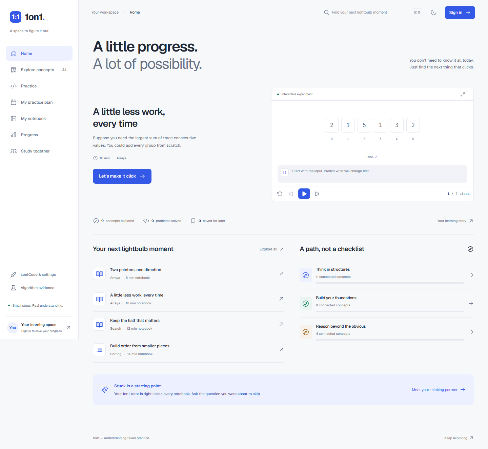

# 1on1

**Make it click.** A visual DSA learning platform built with React, TypeScript, Java, Spring Boot, and persistent storage.

Explore interactive notebooks, change algorithm inputs, answer prediction checkpoints, save your own explanations, and practise in an integrated Java/Python/C++ editor. Gemini supplies contextual help; Java computes visual execution traces and grades runner output.



The screenshot shows the actual local application with an empty guest learning record. [View an interactive notebook](docs/screenshots/notebook.png).

## Run locally

Primary setup: native React/Vite and Java with persistent H2; Docker Desktop Linux containers supply Judge0 and Mailpit. Java 21+, Maven 3.9+, Node 22.14+ and npm are required. Python 3 runs content/reference/HTTP checks; a local C++ compiler is optional for trusted reference verification. See [the Phase 1 handoff](docs/PHASE1_HANDOFF.md) before transferring this project.

```sh
# From this checkout (or an incoming owner's restored Git bundle)
npm run setup
npm run doctor
npm run dev
```

`setup` installs dependencies, compiles Java and generates ignored local service secrets. It creates `.env` only when absent and preserves existing settings and data. It discovers a suitable JDK for child processes without changing global Java or PATH. `dev` starts both app servers and the local service compose file. Do not also start a second Java server.

Open **http://127.0.0.1:5173/**. Vite forwards `/api` to Java on 8080. H2 data lives under `backend/.data`; Mailpit UI is on 8025. PostgreSQL remains optional and needs separate compatibility verification.

**Current workstation limitation:** Docker Desktop became unresponsive while downloading the official Judge0 image, and its backend log reported virtual-disk I/O errors. Actual Java/Python/C++ grading and Mailpit delivery are not verified. Until the owner restores the engine, start the independent learning platform explicitly:

```sh
npm run dev:core
npm run stop:core
```

The normal `npm run stop` stops the owned development processes and local containers while retaining data/volumes. `npm run backup` copies the stopped native H2 database into `.cache/backups`; preserve another copy before restoring. Never delete volumes to repair an ordinary setup problem.

The development-only account is `demo@1on1.local` / `learnwith1on1`, with no fabricated achievements. It is not seeded in the production profile. Incoming owners should create separate test accounts.

## Configure real services

Edit the ignored root `.env` locally and restart Java. Never paste keys into chat, commit them, or put them in `VITE_` variables. Rotate any credential that has already been shared publicly.

| Variable | Purpose |
| --- | --- |
| `GEMINI_API_KEY` | Your Google AI Studio key. Use a replacement if a previous key was exposed. |
| `GEMINI_MODEL` | Defaults to `gemini-3.1-flash-lite`; change to an available structured-output model in your Google project. Free-tier quotas depend on the project/model. |
| `JUDGE0_MODE` | Primary setup is `self-hosted`; `rapidapi` requires an explicit separate configuration. |
| `JUDGE0_URL`, `JUDGE0_AUTH_TOKEN` | Local Judge0 URL (127.0.0.1:2358) and X-Auth-Token. The development launcher supplies the generated ignored token if no override exists. |
| `JUDGE0_API_KEY`, `JUDGE0_RAPIDAPI_HOST` | Only for explicitly selected hosted mode. Never sent in self-hosted mode. |
| `ADMIN_EMAIL`, `ADMIN_PASSWORD` | Optional initial content-editor account. Use a new email and a password of at least 12 characters. Public registration always creates students. Existing accounts are never silently promoted. |
| `SMTP_HOST`, `SMTP_PORT`, `SMTP_USERNAME`, `SMTP_PASSWORD`, `SMTP_TLS` | Password-reset email. Use Mailpit locally or configure authenticated SMTP. |
| `APP_BASE_URL` | Public frontend URL used in reset links. |
| `DATABASE_URL`, `DATABASE_USERNAME`, `DATABASE_PASSWORD` | Optional local PostgreSQL / required production PostgreSQL settings. |
| `POSTGRES_PASSWORD` | Password for the PostgreSQL container in the provided compose setup. It does not change the local H2 connection. |

With no AI key, authored notebooks and deterministic experiments work, and the tutor reports that configuration is missing. With no reachable authenticated Judge0 service, the editor and draft saving work, while Run/Submit report unavailability. No fake AI responses or accepted submissions are generated. Keys are never sent to the browser.

Initial usage limits are 30 AI requests and 50 execution actions per user per UTC day, plus shared daily ceilings of 300 AI and 2,000 execution actions. A hosted judge action can execute several tests and consume multiple provider requests. Provider limits may be lower. Usage is visible to administrators.

## What is implemented

- Versioned curriculum of **24 core concepts**, 47 canonical application references and three paths, taught as visual model → minimal Java → questions. The catalogue retains all old IDs and now contains **33 notebooks**, including child and advanced lessons. Nine new concepts have worked state specifications rather than an unrelated interactive scene. See [the curriculum](docs/CURRICULUM.md) and [validation](docs/CURRICULUM_VALIDATION.md).
- 60 original problems across arrays, strings, hashing, sliding windows, sorting, recursion, trees, heaps, graphs, and DP; 442 public/hidden judge fixtures. All 60 Java references pass; the eight problems linked to the reference journeys also have verified Python/C++ references.
- Version 2 Java traces with stable IDs and semantic operations; reusable playback/renderers, meaningful motion in the four reference journeys, exact seeking, editable inputs/seed, synchronized pseudocode and text transcripts.
- Java-graded prediction, pattern, manipulation and dry-run challenges; answer keys omitted from initial public content. Contextual Gemini help, real SSE streaming, validated AI experiments and private conversation history. Explanation/visualization/streaming verified live.
- Java/Python/C++ Monaco editor, local editor workers, persistent drafts, real asynchronous Judge0 adapter, deterministic output comparison and private hidden cases.
- Accounts, onboarding, private notes, bookmarks, basic revision/plans and cohorts; complete input/step resume and versioned code drafts. Validated events distinguish exploration, challenge passes and unique accepted credit. Dated planning, spaced review and PDF retrieval belong to Phase 2; email delivery still needs live verification.
- Public LeetCode profile connector with cached snapshots, recent accepted problems, manual refresh cooldown, six-hour scheduled refresh, and explicit stale/unavailable states.
- Administrator content editing, JSON import/export, draft/publication controls, and usage overview.
- Algorithm evidence view with seeded comparative benchmarks and JSON export.
- Responsive light/dark/system themes, keyboard navigation, focus states, text alternatives, and reduced-motion styles.

## Algorithms assessed

All three are original Java implementations under `backend/src/main/java/com/oneonone/algorithms`:

| Technique | Application use | Analysis |
| --- | --- | --- |
| Trie (Unit 4) | A cached, immutable title/topic prefix index rebuilt after content changes. | Prefix traversal plus bounded output; indexing cost and memory are separate. |
| Greedy set cover (Unit 5) | Compact practice sets covering selected topics, excluding solved problems. | Unit-cost approximation; infeasible coverage is reported. Daily grouping is separate. |
| Randomized Quickselect (Unit 6 / CO5) | Cohort activity-score quartile thresholds without complete sorting. | Expected O(n), worst O(n²); three-way partitioning handles duplicates; inputs are copied. |

The full explanation, pseudocode, test matrix, and performance methodology are in [the technical report](docs/TECHNICAL_REPORT.md). Use `/evidence` after signing in to generate machine-specific measurements. Benchmarks are not invented marketing claims.

## Verify

```powershell
# Java algorithms, traces, all reference solutions, and runner adapter contracts
mvn -f backend/pom.xml test

# TypeScript production build and API-boundary unit tests
npm run build
npm test

# Real HTTP integration checks, with Java running
python scripts/verify_api.py

# Browser flows and responsive screenshots, with both servers running
npx playwright install chromium
npm run test:e2e
```

A source-only restore and repeat setup were rehearsed locally with separate data. Use `npm run verify` for Java/frontend/build checks, `npm run verify:references` for trusted authored Python/C++ references, and `npm run verify:live` with the app running for actual provider evidence. Live verification exits nonzero if a required provider is blocked. Judge adapter tests use a local fixture server and do not establish sandbox compatibility. Actual Gemini passed; Docker/Judge0, SMTP and LeetCode remain separate live gates. Browser tests capture desktop/mobile evidence under the ignored `.impeccable/review` directory.

Regenerate deterministic authored content with `python scripts/generate_content.py`. Content seeds update unedited built-in records on startup; changes saved through the admin UI are marked as edited and preserved. Retired, unedited built-ins are archived, not deleted. Take database backups before content or schema upgrades.

## Team development

Follow the [three-phase plan](docs/IMPLEMENTATION_PLAN.md), [current handoff](docs/PHASE1_HANDOFF.md) and [feature catalogue](docs/FEATURES.md). UI and animation refinement is expected in every phase; preserve shared contracts and existing data. The Phase 1 execution exit gate remains open.

One Java service owns business logic. Frontend API contracts are in `src/types.ts` and documented in [API.md](docs/API.md).

- **Frontend/notebooks:** `src`, tokens in `src/styles.css`, browser tests.
- **Java/algorithms/data:** backend modules, SQL migrations, JUnit tests, benchmarks.
- **AI/execution/integrations:** Gemini/LeetCode/Judge0 adapters, content tooling, and service error handling.

Share content and review responsibilities. Each student should commit their own work and record actual contributions in the proposal/report. The initial implementation was assisted by Codex; do not represent it as independently authored student work. Understand and be prepared to explain the Java implementations during the viva.

## Container deployment

This older optional topology is separate from the primary native setup and has not been rehearsed live. It does not install Judge0; see the service/authentication distinctions in the handoff. The complete Java architecture is packaged for a Java/container host. It is not a frontend-only static deployment.

```powershell
# Configure the ignored .env first; set a strong DATABASE_PASSWORD
docker compose up --build -d
```

Open http://localhost:8088. Nginx serves the frontend and proxies Java; PostgreSQL uses a named volume. Mailpit is available locally on http://localhost:8025 for reset emails when the compose SMTP default is used. See [deployment instructions](docs/DEPLOYMENT.md) before exposing this to the internet.

Do not use `docker compose down -v` unless you intend to delete stored data. Set `COOKIE_SECURE=true`, a real `APP_BASE_URL`, proper SMTP, and TLS on the public reverse proxy for production. Back up PostgreSQL and keep service keys only in the hosting secret store.

## Academic package

- [Project proposal](docs/PROPOSAL.md)
- [Technical report](docs/TECHNICAL_REPORT.md)
- [API and data contracts](docs/API.md)
- [Demonstration script and requirement mapping](docs/DEMO.md)
- [Validation record](docs/VALIDATION.md)

Add the actual two/three team members' names, IDs, and individual contributions before submission. Faculty determines project acceptance and the final assessment.
