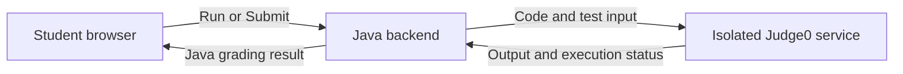
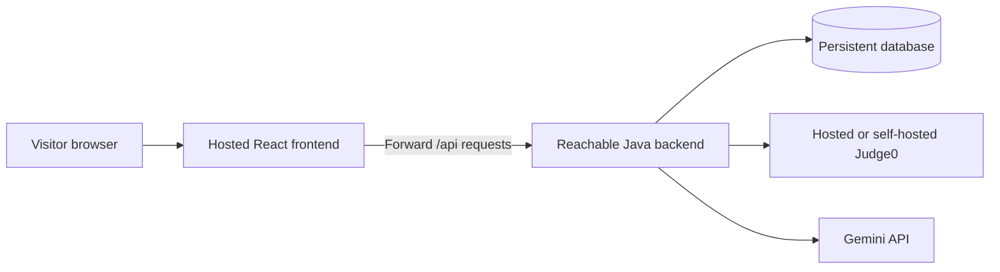

# 1on1 — Start here for project handoff

**Current update — 16 November 2026:** start with [PHASE1_HANDOFF.md](PHASE1_HANDOFF.md) for the implementation, setup commands, exact Docker blocker, verification and incoming backlog. The approved [three-phase plan](IMPLEMENTATION_PLAN.md) assigns later phases to the two teammates. Native setup is now managed by `npm run setup` / `dev`; self-hosted authentication and durable execution are implemented. Actual Gemini explanation/visualization/streaming passed. Docker Desktop failed during the Judge0 image pull, so real grading, SMTP and PostgreSQL remain unverified.

The discussion below is retained as the **15 November historical decision record**. Its explanations about optional deployment, laptop dependencies and provider pricing remain context; its implementation-status tables and old adapter instructions are superseded by the current handoff. The original faculty PDF remains the assessment authority.

This guide records the deployment, code-execution and service decisions discussed with the project owner. It describes the current implementation and separates working local behavior from integrations that still require configuration or live verification. Last updated: 15 November 2026.

## Is online deployment required for CIA 3?

**No. A working local application is acceptable.** Page 4, section 10 of `CIA3_Advanced_Algorithm_Project_Guidelines_2026-27.pdf` states:

> If deployment is not feasible, a fully working local application is acceptable, provided setup is reliable and the end-to-end flow can be demonstrated.

The team still needs a functioning frontend connected to its Java backend, reliable written setup instructions, representative data, error handling, algorithm evidence and a live end-to-end demonstration. Online hosting is optional; it does not replace these requirements. The original college PDF is the assessment authority and should be passed to the receiving team separately.

For the college demo, the practical starting point is the local setup in the [repository README](../README.md#run-locally). Keep actual student names, IDs and contributions up to date in the proposal/report before submission.

## What Judge0 does

Judge0 is an isolated code-execution service. It is separate from the React frontend, the Java application backend and Gemini.

When a student clicks **Run** or **Submit**:

1. React sends the code, language and problem identifier to the Java backend.
2. Java saves a submission snapshot and sends code/test input to Judge0.
3. Judge0 compiles/runs the code within resource limits and returns output or execution errors.
4. Java compares official test outputs, records results and awards native solved credit only after acceptance.

Custom runs do not award solved credit. Public examples may display expected/actual output; hidden inputs and expected outputs stay server-side. Gemini gives explanations and hints; it does not grade solutions. Our Java algorithm implementations also run in the application backend independently of Judge0.

The current editor supports Java, Python and C++. Without a configured Judge0 service, students can still write/save drafts and use the learning platform, but live execution/grading is unavailable. An unavailable-service message is not a successful grading demonstration.

## Does Judge0 have a free tier?

Judge0's [official API documentation](https://ce.judge0.com/) advertises a free Basic plan through RapidAPI. However, the current quota, card requirement, overage terms and availability were **not independently confirmed** from the dynamic subscription page. Check the [actual RapidAPI plan](https://rapidapi.com/judge0-official/api/judge0-ce/pricing) before subscribing. Do not assume the often-repeated “50 submissions per day” figure is current or that a zero monthly fee means every execution is free.

Provider usage is different from 1on1's internal usage limits. A single official submission currently runs multiple fixtures separately: seven test cases can create seven execution jobs, with additional result-polling requests. The provider's plan determines which units are metered. The application's 50 execution actions per user per day is an internal limit, not a promise of hosted API allowance.

Judge0 can also be self-hosted. Its open-source license does not require paying for the hosted API, but you supply the compute, storage, network and maintenance. See the [official repository/deployment instructions](https://github.com/judge0/judge0). Review current compatible releases and requirements when setting it up.

## Where each component runs

Hosting the frontend does **not** automatically connect anything to the developer's laptop.

| Setup | Frontend | Java backend / data | Code execution | Laptop dependency |
| --- | --- | --- | --- | --- |
| Local app with hosted judge | Laptop | Laptop / persistent local H2 | Judge0 provider | Laptop is needed for the app; execution also needs internet and provider access. |
| Fully local demo | Laptop | Laptop / local storage | A separately installed local Judge0 instance | Laptop must be on. Local judge setup and adapter changes are still required. Gemini still needs internet. |
| Fully online platform | Vercel or another frontend host | A reachable Java/container host and persistent database | Hosted Judge0 or a separately hosted instance | The developer's laptop is not involved. |
| Online frontend with laptop services | Frontend host | Java and/or Judge0 on a laptop | Depends on the deliberately configured connection | Laptop must stay on, awake, online and securely reachable; its outage breaks the dependent feature. |

**The supplied `compose.yaml` does not install Judge0.** It contains the web frontend, Java API, PostgreSQL and Mailpit. Its default Judge0 URL points to the hosted RapidAPI service. Running the website locally or starting compose therefore does not make grading automatically local or offline.

## If the frontend is hosted on Vercel

Treat this as a split deployment that still needs to be configured and verified:

- The React build uses `npm ci`, then `npm run build`, with output in `dist`.
- The frontend currently requests relative `/api/v1/...` URLs. `vite.config.ts` proxies these to Java only during local development. That development proxy is not shipped in the production build.
- Configure the production host/reverse proxy to forward `/api` to the actual Java backend. Vercel documents [rewrites to external origins](https://vercel.com/docs/routing/rewrites). No Vercel-specific deployment/rewrite configuration is currently included or tested in this repository.
- Keep SPA navigation working for paths such as `/learn/lesson-sliding-window` and `/practice/...`. API forwarding must take precedence over a frontend index fallback.
- The selected architecture uses a long-running Java service with sessions, scheduled refresh and background execution work. Deploy that service on a host supporting these behaviors; publishing the React files alone does not deploy it.
- Verify session cookies, CSRF, HTTPS, forwarded responses, SSE tutor streaming, timeouts and disabled caching of personalized/API content. If switching to direct cross-origin browser API calls, explicitly implement and test CORS and credential-cookie behavior; the current same-origin setup does not configure that alternative.
- Store AI/judge/database credentials on the Java host, not in Vercel frontend variables or bundled JavaScript. Set the real frontend `APP_BASE_URL` for password-reset links and secure cookies for HTTPS deployment.

`localhost` and `127.0.0.1` always refer to the machine making that connection. A cloud proxy pointing at localhost reaches itself, not your laptop. A visitor's browser calling localhost reaches the visitor's computer. Neither creates a connection to the developer's machine.

The repository's existing full-container option puts Nginx, Java and PostgreSQL together instead of splitting frontend hosting. See [DEPLOYMENT.md](DEPLOYMENT.md) for its setup and environment differences.

## If Judge0 runs on a laptop

An online Java backend can use it only if the laptop service is deliberately exposed through an authenticated, securely reachable connection, such as a suitably configured HTTPS tunnel/private network. This is not automatic and no tunnel is supplied here. Restrict the execution service rather than publishing an unauthenticated code runner.

The laptop must remain powered on, awake and connected. Sleep, shutdown, internet failure or a changed connection can stop grading. The hosted frontend can remain visible while execution requests fail. For a continuously available public platform, a server-hosted execution service avoids this laptop dependency.

For a local classroom demonstration, services can communicate locally without a public tunnel. However, self-hosting is an **integration task still to implement**, not a configuration that has already been validated:

1. Install Judge0 using its official supported deployment environment and preserve sandbox/resource isolation.
2. Inspect `backend/src/main/java/com/oneonone/ExecutionService.java`. The current adapter considers execution configured only when `JUDGE0_API_KEY` is nonempty and sends `X-RapidAPI-Key` / `X-RapidAPI-Host` headers.
3. Add/test explicit hosted versus self-hosted authentication handling. Standard self-hosted Judge0 can use `X-Auth-Token`, with configurable authentication settings; changing `JUDGE0_URL` alone is not guaranteed to work. Do not use a dummy key as a substitute for a properly designed authentication mode.
4. Verify installed language IDs/versions, create/poll routes, network disabling, CPU/wall/memory/output limits, Java memory behavior and all three student languages.
5. Run official and custom submissions; verify hidden-data redaction, failure handling, accepted-only credit and provider outages. Keep untrusted student execution out of ordinary Java subprocesses on the application host.

## Configuration and current verification status

Use the ignored root `.env` for local settings and the Java host's secret storage for online deployment. Copy variable names from `.env.example`; do not transfer real keys through these docs or Git. A previously shared Gemini credential must be replaced and configured locally. No real key is included in the source.

| Component | Handoff status / next action |
| --- | --- |
| Local learning platform | Built and tested with persistent H2; see [validation record](VALIDATION.md). |
| Java algorithms | Custom trie, set cover and randomized Quickselect, correctness tests, three-size benchmarks and exported measurements included. |
| Gemini | Adapter, streaming, scene validation and errors implemented. Configure a replacement `GEMINI_API_KEY` and verify an actual explanation/visualization with an available model. Free-tier quotas can pause service. |
| Hosted Judge0 | Adapter and local contract tests implemented. Configure provider credentials and run real Java/Python/C++ submissions. Hosted sandbox availability was not tested live. |
| Local/self-hosted Judge0 | Not included in compose; requires installation, authentication-mode work and verification described above. |
| LeetCode | Unofficial public-profile connector implemented. Verify the desired username/upstream access; cached statistics and recent submissions do not constitute a full historical solved list. |
| Email | Reset flow implemented; verify actual Mailpit/SMTP delivery and sender configuration. |
| Docker / PostgreSQL | Compose configuration parses. Full container startup was not tested because the local Docker Linux engine was off. |
| GitHub CI | Initial remote job never started: GitHub reported an account billing lock before any build/test steps. Repository owner must resolve the account-level restriction before remote CI can validate the project. This is separate from passing local tests. |
| Public deployment | Not performed. Vercel routing, a public Java host, hosted database and externally reachable judge have not been provisioned. |

`GET /api/v1/system` reports whether keys/settings are present; its configuration booleans are not live provider-health tests.

## Suggested handoff sequence

1. Read this guide, [README](../README.md), [API contracts](API.md) and [deployment instructions](DEPLOYMENT.md). Get the original faculty guidelines and actual team details from the owner.
2. Run the app locally and repeat the recorded Java/frontend/HTTP/browser checks. Preserve the distinction between synthetic fixtures, adapter contracts and real provider calls.
3. For the college demo, keep the frontend and Java backend local. Choose and configure either hosted grading or a properly integrated local judge if demonstrating Run/Submit. A complete end-to-end demo remains necessary even though public hosting is optional.
4. Verify Gemini and email with replacement/local credentials. Confirm failures remain understandable and saved work survives them.
5. If public hosting is desired, choose the complete topology first. Provision all required services, then verify the full browser → Java → judge/database → response flow; do not treat a deployed landing page as a deployed platform.
6. Record fresh benchmark results, live-service evidence, actual contributions and any changed limitations before assessment or release.

## Git handoff boundary

The owner initially requested documentation remain local and unpushed. The subsequently approved implementation plan authorises a **local Git checkpoint and transferable history bundle**, including preservation of those documentation changes. It still does **not** authorise pushing or public deployment. Keep any publication as a separate later owner decision.
