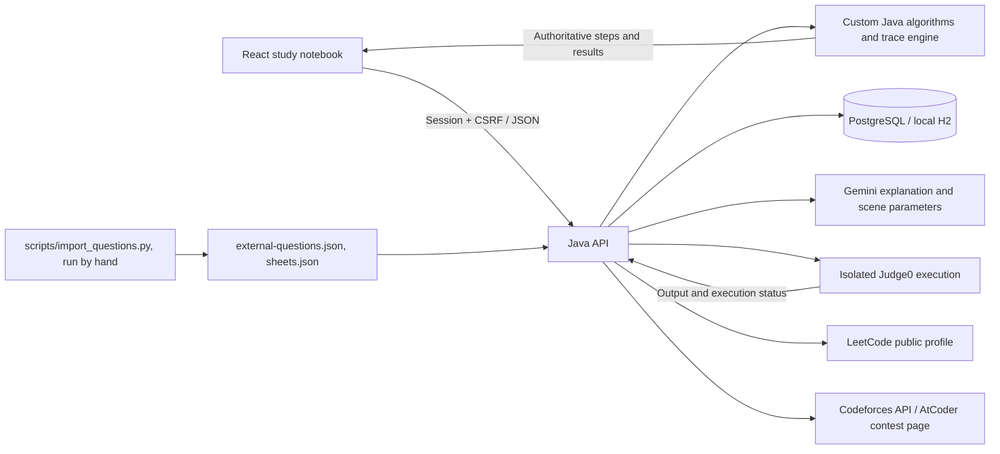

# 1on1 — Technical report

> Refreshed 17 November 2026 for the Phase 3 state of the repository. Feature status: [FEATURES.md](FEATURES.md). Phase 2 evidence: [PHASE2_HANDOFF.md](PHASE2_HANDOFF.md). Endpoints: [API.md](API.md). Benchmarks: [VALIDATION.md](VALIDATION.md). Live Judge0 execution, live Gemini answers and a PostgreSQL rehearsal are still unverified; nothing in this report should be read as evidence that they work.

Advanced Algorithm CIA 3 · Semester V · 2026–27

This report describes the implemented system. Benchmark numbers belong to the exported results for the machine on which the experiments ran. They must not be inferred from theoretical complexity. The team must add official student names, IDs, and actual individual contributions before submission.

## 1. Problem, users and success criteria

1on1 connects algorithm explanation with observable execution and deliberate practice. The target user is a student who can read pseudocode but needs to understand why a state transition is valid. Existing learning workflows scatter explanations, coding attempts, revision and progress across unrelated tools. The operational problem is finding relevant material, assembling focused practice and interpreting progress without turning the application into a passive content list.

The main workflow is an interactive notebook: read the idea, edit the experiment input, predict the next action, step through computed states, record an explanation and solve a related problem. A native coding submission is credited only after deterministic grading. A topic plan is produced by a coverage algorithm rather than a manually chosen static list. A prefix index drives catalog retrieval. Cohort summaries use randomized selection to obtain thresholds without requiring a full ranking.

Success means the workflow works end to end, saved state survives refresh, algorithms return correct interpretable outputs, and experiments show measured behavior at increasing sizes. The product contains 33 lessons (24 core concepts, 2 child lessons and 7 advanced lessons), 60 original judged problems with 546 fixtures, three paths, a question bank of 16,331 external question links, and five Prep tracks. Synthetic benchmark records are labelled and do not appear as genuine student activity.

The platform deliberately describes activity rather than claiming to measure mastery. Lesson completion is a student's own acknowledgement. Native accepted problems, checkpoint answers, notes and imported profile statistics are separate forms of evidence.

<div style="page-break-before:always"></div>

## 2. Architecture and data flow

React/TypeScript provides the user interface, with shared design tokens, accessible controls and responsive notebook layouts. TanStack Query manages server state. Monaco and its worker are loaded only when a coding workspace is opened. Java 21-compatible Spring Boot code owns application logic, validation, assessed algorithms and execution traces. PostgreSQL is the deployment database; a persistent H2 database supports local use. The PostgreSQL compatibility rehearsal has not been run (it needs the owner's database credentials).



The `members` table stores account identifiers, emails, names, BCrypt password hashes and roles. `documents` stores typed content and user-owned learning records as JSON with a stable ID, owner, kind and update timestamp. Additive migrations V2–V4 add challenge attempts, learning events, solved credits, review evidence and the document notebook. Flyway manages the relational schema.

The document store keeps the small project's persistence model compact. It is a conscious tradeoff: JSON fields have weaker database-level validation and analytical query support than fully normalized tables. Controllers enforce domain validation and ownership; prepared statements avoid SQL interpolation. Public content uses a dedicated owner namespace. Private notes, drafts, plans and submissions require the authenticated member's owner ID.

Accounts use server sessions, HttpOnly cookies and CSRF tokens on mutations. Signup always creates a student. A content editor is bootstrapped only from explicit server configuration. Password reset emails contain expiring one-use tokens; failed delivery does not reveal whether an account exists.

### Services added after Phase 1

All are in `backend/src/main/java/com/oneonone/` unless another path is given.

| Service | Responsibility | State |
| --- | --- | --- |
| `LearningMapService`, `ReviewSchedule`, `PlanService` | Concept map in prerequisite order, evidence states, spaced review, dated plan tasks | Database (documents and attempt/credit tables) |
| `CoachService`, `TutorService` | Guided coding coach; graduated Blob help with coach context | Database; Gemini at the boundary |
| `NotebookService` | PDF extraction (PDFBox), BM25 retrieval (Lucene), cited answers, revision cards | Database |
| `BankService` | Question bank search, filtering, sorting, company lists | Read-only JSON resource held in memory |
| `SheetController` | Blind 75 / NeetCode 150 sheets, ticks, top reporting companies per item | `sheets.json`; ticks in the database |
| `ContestService` | Upcoming contests from two external sources with caching | In-memory cache per source |
| `BoardTraces` | Step-by-step traces for the 16 board concepts, drawn by one generic renderer | Stateless; bounded teaching inputs |
| `QuizService` | Quiz-style mock OA: mixed sections, timed, graded on the server | Database |
| `PlanAdvisor` | Plan suggestions from the learner's record; Gemini when configured, validated, with a rule fallback | Database; Gemini at the boundary |
| `StudyCircles` | Weekly circle problem and member weekly activity | Stateless |
| `DrillService` | Seeded aptitude and reasoning question generators and grading | Stateless; logs one learning event per topic per day |
| `PrepController` | Prep guides, server-graded quizzes and puzzle answer checks | Content from `content.json` |
| `MockService` | Timed mock assessments scored from official accepted runs | Database |
| `src/pages/prep/trafficModel.ts` | Queueing model behind the system design playground | Browser only |
| `mcp/server.mjs` (Node) | Read-only MCP adapter over the public API; owns no logic | None |

<div style="page-break-before:always"></div>

## 3. Assessed algorithms and correctness

### Trie: catalog prefix retrieval, Unit 4

Keys are trimmed and lowercased with a stable locale. Each character selects a child node. Terminal nodes hold unique record identifiers. Search follows the prefix, then performs lexicographic bounded enumeration, deduplicating records reachable through multiple indexed keys. The public search service publishes an immutable snapshot containing the trie and matching records. It is rebuilt after startup/content changes; requests do not rebuild it.

```text
insert(term, id):
  node = root
  for character in normalize(term):
    node = get-or-create node.children[character]
  node.ids.add(id)

search(prefix, limit):
  follow the normalized prefix from root
  if an edge is absent: return []
  enumerate terminal ids and descendants until limit unique ids
```

The path invariant is that the current node spells exactly the consumed prefix. A missing edge proves that no indexed key begins with the query. Enumerating below the final node yields only matching keys. Unique postings and output deduplication prevent duplicate results. With a bounded character alphabet, traversal is O(L), plus traversal/output needed for returned completions. Storage is O(total indexed characters plus postings); index construction and memory are distinct from query latency.

### Greedy set cover: topic practice plans, Unit 5

The universe is the student's requested topics. Each eligible unsolved problem contributes a topic set. The application filters difficulty and completion before constructing candidates. Every question has equal selection cost; questions-per-day grouping happens after coverage selection. Plan regeneration keeps completed tasks and re-runs selection only for topics they do not already cover.

```text
remaining = requested topics
while remaining is not empty:
  choose unused candidate with greatest |topics ∩ remaining|
  break if every gain is empty
  record the newly covered topics
  remove them from remaining
return selected questions and remaining uncovered topics
```

The invariant is that `remaining` contains exactly the requested topics not covered by selected questions. Each useful iteration removes at least one topic, so the process terminates. If it stops with uncovered topics, no unused eligible question contributes any of them; reporting infeasibility is correct. Stable identifier tie-breaking makes demonstrations reproducible. Selection is an approximation: it does not guarantee the fewest possible questions. For unit-cost feasible set cover, the standard greedy quality bound is harmonic in the universe size. The straightforward implementation costs O(P·T·min(P,T)) with O(P·T) stored membership data.

### Randomized Quickselect: cohort activity thresholds, Unit 6 / CO5

The Java selector copies the input, samples a random pivot in the active interval, and performs a three-way partition into smaller, equal and larger values. It then continues only in the interval containing the requested zero-based order statistic.

```text
while low < high:
  pivot = randomly chosen value in [low, high]
  partition into < pivot, = pivot, > pivot
  if k is in the equal interval: return pivot
  otherwise retain only the interval containing k
return values[low]
```

The partition establishes that every smaller value precedes the equal interval and every greater value follows it. The desired rank therefore remains in the retained interval, or is already answered by the pivot. Three-way partitioning avoids repeatedly peeling identical pivots from duplicate-heavy data. Expected running time is O(n), worst case O(n²); the defensive copy uses O(n) space. Random seeds control reproducible experiments, not a claim of worst-case linear behavior.

Quartiles use the nearest-rank convention: rank `ceil(p*n)-1`, clamped to zero. Three selections still have expected O(n) total time because their count is constant. Ties are values, not an assertion that a specific proportion of students strictly outranks another. The independent cohort-summary endpoint reads scores without sorting or returning a full leaderboard. Native score uses unique accepted problems weighted 1/3/5 by difficulty; external profile totals do not affect it. This probabilistic algorithm gives the project meaningful CO5 coverage.

<div style="page-break-before:always"></div>

## 4. Algorithms in the later services

These are supporting algorithms, not the assessed Unit 4–6 techniques above. Each is covered by the test class named.

### Seeded question generation (`DrillService.java`, `DrillTest`)

Each of the 13 aptitude and reasoning topics has a generator that is a pure function of `(topic, seed)`. The generator seeds `java.util.Random` with `seed × 0x9E3779B97F4A7C15 + topic.hashCode()`, because neighbouring seeds otherwise produce near-identical first draws. Because a question can be regenerated from its seed, the server sends only the prompt and seed, and regenerates the question to grade an answer. No answer is stored or sent first, and no per-question state is kept.

Parameters are drawn so that every numeric answer is an integer: a percentage `p` is applied only to multiples of `100 / gcd(p, 100)`; time-and-work pairs come from a table where `a·b` is divisible by `a + b`; train speeds are multiples of 18 km/h so the m/s conversion is whole; HCF/LCM questions are built as `h·x` and `h·y` with coprime `x, y`; direction problems use 3-4-5 triangles or cancelling legs, rotated and mirrored at random. Number series use one of four rules (arithmetic, geometric, n² + k, alternating differences). Syllogisms use seven fixed templates with random nouns; the verdict for each template is authored, following the usual aptitude-test reading of "all" and "some".

Grading compares numbers with `BigDecimal.compareTo` after removing thousands commas and a typed unit (`%`, `₹`, `Rs`, `days`, …), and compares text ignoring case. Answers longer than 64 characters are rejected before any pattern is applied, so public input cannot make the regular expressions run long. Seeds are integers in 0..2³¹−1. "Unlimited" means any number of draws; the number of distinct questions per topic is bounded by each generator's parameter ranges.

### Contest caching and failure handling (`ContestService.java`, `ContestTest`)

Two sources are read: Codeforces through its official `contest.list` API, and AtCoder by parsing the upcoming-contests table on its public contest page (its robots.txt allows `/contests/`). Each source keeps its own state: last good list, `checkedAt`, `fetchedAt` and `ok`.

On a request, sources that are due (one hour after a success, ten minutes after a failure) are claimed inside a lock by setting `checkedAt`; the fetch then happens outside the lock. A concurrent request therefore sees the source as not due and returns the cached snapshot instead of waiting behind a slow site. A failed fetch or parse sets `ok = false` and keeps the previous list. HTTP calls have an 8-second connect and 10-second request timeout. The snapshot drops contests whose start plus duration has passed and sorts by start time, then title. The HTTP function and clock are injected, so the tests cover merging, a failing source, the cache window, outage survival, ended contests and the non-blocking claim without network access.

The AtCoder parser depends on the page's markup; if AtCoder changes it, the source reports `ok: false` rather than showing wrong data. LeetCode and CodeChef schedules are not read; the page links to them.

### Board traces (`BoardTraces.java`, `BoardTracesTest`)

Each of the 16 board concepts runs the real algorithm in Java and records, at every step, the panels to draw: arrays with per-cell marks, a stack or deque, text with the pattern's offset, a table with the active cell and the cells it read, or a graph with edge and vertex states. The client draws panels as sent, so a new concept needs a trace but no new renderer. Inputs are bounded to teaching sizes (8 vertices, 16 edges, 12 values, 24-character text, capacity 12). `BoardTracesTest` checks every default input ends on the textbook answer, that a cycle and a negative cycle are reported, and that out-of-range inputs are rejected.

### Question bank filtering and sorting (`BankService.java`, `BankTest`)

The external list (16,331 records) is loaded once from `external-questions.json` with double-checked lazy initialisation and is immutable after that. 1on1's own problems are read from the store and cached for 60 seconds, so an admin edit appears within a minute. A search is a linear scan over about 16,400 records with case-insensitive filters for title substring, source, difficulty, topic and company, followed by an optional sort and a page slice (`size` clamped to 1–100). Cost per request is O(N) for filtering plus O(m log m) to sort the m matches.

Sorting uses a difficulty score: the Codeforces rating or AtCoder Problems difficulty estimate when present, otherwise Easy = 1000, Medium = 1600, Hard = 2200. Unrated questions (all CSES questions) get `Integer.MAX_VALUE` and stay last in both "easiest" and "hardest" order. Every comparator ends with the question id, so pages are stable across requests. With a company filter and no explicit sort, results are ordered by that company's report count, descending. The Codeforces and AtCoder scales are not equivalent, and the LeetCode mapping is a convention, so mixed-source sorting is approximate.

### Queueing model for the traffic playground (`src/pages/prep/trafficModel.ts`, `trafficModel.test.ts`)

The system design playground runs entirely in the browser. The app tier is an M/M/c queue: with offered load a = λ/μ, the probability of waiting is Erlang C, computed iteratively, and the mean response time is C(c, a) / (cμ − λ) + 1/μ. A cache answers a share h of requests in about 1 ms. The database is an M/M/1 queue that sees only the misses, with mean response time 1 / (μ_db − λ_db). Each tier admits at most 95% of its capacity, because queue length grows without bound as utilisation approaches 1; the excess is counted as dropped. Mean latency is app time + h × 1 ms + (1 − h) × database time. The bottleneck is the busier tier once either passes 80% utilisation.

Assumptions: Poisson arrivals, exponential service times, one shared app queue, no network time. The tests check the M/M/1 case, a two-server Erlang C value, dropping, the cache's effect on the database, that more servers never increase latency, and finite results at the extremes. It is a teaching model, not a capacity planner.

<div style="page-break-before:always"></div>

## 5. Data sourcing and licensing

External data is imported by `scripts/import_questions.py`, which is run by hand; the application only reads the generated files. The rule is to import only what a source's licence or published access policy allows, to store metadata and links but never problem statements, and to link to anything else.

| Source | What is imported | Basis |
| --- | --- | --- |
| Codeforces `problemset.problems` API | Names, ratings, tags, links (11,526) | Official public API |
| AtCoder Problems (kenkoooo) | ABC/ARC/AGC tasks with a difficulty estimate, linked to atcoder.jp (2,943) | Public resource files, fetched once with a pause between requests |
| CSES problem set page | Titles, sections, links (400) | Public index page; no statements |
| `hxu296/leetcode-company-wise-problems-2022` | LeetCode titles, links, difficulty and community-reported company tags, data as of May 2022 | MIT licence, © 2022 Huan Xu |
| `neetcode-gh/leetcode` | Pattern tags, extra LeetCode questions, Blind 75 and NeetCode 150 lists (`sheets.json`) | MIT licence, © 2022 neetcode-gh |
| Codeforces `contest.list`, AtCoder contest page | Upcoming contests, read at run time | Official API; AtCoder's robots.txt allows `/contests/` |

Not imported, and why:

- **LeetCode itself** is never contacted for the bank; its data comes only from the MIT dataset above. The profile connection reads a learner's own public profile through an unofficial endpoint, which is a stated limitation.
- **Newer company-wise lists** were not used. No openly licensed source was found; recent company-wise repositories carry no licence and are scraped from LeetCode Premium. Company data in 1on1 is therefore dated May 2022 and labelled community-reported.
- **Striver's sheets** and other lists whose terms forbid copying are linked, not imported.
- **LeetCode and CodeChef contest schedules** are linked, not read, because neither offers a public schedule the app may read.
- **Problem statements** from any external site are not stored. "Solve here" opens an editor with a link to the original statement and runs only the learner's own input.

Other content: the 60 problems, 33 lessons and Prep guides are original. The curriculum's 42 external question URLs were matched against two pinned Amazon CSV snapshots; that records source membership, not interview frequency ([API.md](API.md)). The landing-page photo is used under the Unsplash licence with a visible credit (`src/pages/LandingPage.tsx`).

<div style="page-break-before:always"></div>

## 6. Visualization, AI and judging

The trace engine accepts a supported algorithm, bounded integer input, a target/window/rank, and optional words. It produces a versioned trace with independent state snapshots, stable entity IDs, variable values, active positions, pseudocode line references and explanatory text. A step's array is copied so later mutations cannot rewrite previous states. The frontend renders these records rather than executing an assessed algorithm in browser libraries. The Animations gallery (`src/pages/Animations.tsx`) reuses the same traces; the gallery requests a trace only when the learner presses play.

Interactive sizes are deliberately bounded for interpretability (at most 32 values). Large-scale performance evidence uses separate benchmark datasets. Recursion and DP have explicit scalar limits. Invalid input receives a useful message. Graph scenes derive a small directed graph from the numeric input and disclose that construction. Tracing of a learner's own source code is not built (section 9).

Gemini's structured mode selects supported scene parameters and supplies explanations. Java validates the proposed parameters and computes the trace. Normal tutoring streams text through the Java API with the current lesson, selected step, sanitized submission context, coach record (no solution code) and a bounded recent conversation. AI is never given hidden judge inputs. Help has four graduated levels; a full solution needs an explicit request. Provider refusal, malformed output, interruption and free-tier exhaustion have explicit recovery states. Authored lessons remain usable without AI access. No key is configured on the dev machine, so these paths are tested to the provider boundary only.

Student code is sent only to the configured isolated Judge0 service. Source is saved as an immutable submission snapshot. A bounded worker pool (two workers, queue of 20) creates jobs and polls their status, with network access disabled and CPU, wall-time, memory and output limits. Java applies the official output contract: normalized line endings and trailing whitespace. Public tests may show input/expected/actual output; hidden tests show only status. Custom runs, "solve here" runs and the coach never award credit. Repeated acceptance contributes one solved identifier. Unavailable configuration never creates an accepted result. Docker is not available on the dev machine, so no live run has been made.

<div style="page-break-before:always"></div>

## 7. Correctness and integration validation

`npm run verify` passes on 17 November 2026: 149 backend tests, 40 frontend tests and the production build. The browser suite (95 specs) is being re-run; its result will be recorded in the handoff, not here.

The Java suite includes more than five tests for each assessed technique (`AlgorithmsTest`):

| Technique | Correctness and boundary scenarios |
| --- | --- |
| Trie | Empty index/missing prefix; whitespace/case normalization; shared prefixes and bounded output; duplicate postings; zero/invalid limits. |
| Set cover | Empty goals; infeasible coverage; stable ties; overlapping coverage with newly added topics; seeded small datasets compared against exhaustive subset enumeration. |
| Quickselect | Single value; invalid/empty input; identical values; sorted/reversed/negative values; many ranks and seeds compared against sorting; input preservation; nearest-rank quartiles. |

The set-cover test's exact solver is restricted to tiny candidate sets and is a correctness/quality oracle. Quickselect validation checks actual selected values rather than mirroring its partition implementation. `TraceTest` and `VisualTraceTest` execute all supported scenes and verify bounds, independent snapshots and results. `ContentTest` compiles every Java reference solution and runs it on all 546 fixtures; `CurriculumTest` compiles every teaching example and runs its cases.

Tests for the later services:

| Area | Test class | What it checks |
| --- | --- | --- |
| Drills | `DrillTest` | 13 topics; determinism and self-consistency per seed; answer formats with units; oversized answers rejected; guests not recorded; one event per topic per day |
| Contests | `ContestTest` | Merge order and UTC times; one failing source; one-hour cache and outage survival; ended contests dropped; a slow source does not block others; a bad row is skipped |
| Lab | `LabTest` | Closest curve per algorithm; monotone step counts; repeatability; curves meet the measurement at n = 32; unknown algorithm is 404 |
| Bank | `BankTest` | Own problems first; filters; company ordering; empty pages; stable difficulty sorting with unrated last; title sort and fallback |
| Sheets, LeetCode sync | `SheetTest` | Sheet lists and items; ticks per learner; LeetCode sync ticks only accepted sheet questions; top reporting companies per row |
| Prep | `PrepTest`, `PrepContentTest` | Guides served without answers; guide quiz grading; puzzle answers checked on the server and never sent ahead |
| Solve here | `ExternalRunTest` | An external question runs on the learner's input and is never judged; unknown ids refused |
| Coach, map, review, notebook, admin | `CoachTest`, `PlanAndMapTest`, `ReviewScheduleTest`, `NotebookTest`, `AdminChecksTest`, `TutorLevelsTest` | As listed in the Phase 2 handoff |
| Queueing model | `src/pages/prep/trafficModel.test.ts` | M/M/1 and Erlang C values, dropping, cache effect, monotone latency, extremes |
| Calendar export | `src/pages/contests/ics.test.ts` | `.ics` output |

Runner contract tests (`ExecutionAdapterTest`) use an isolated local fixture server. They validate hidden-case redaction, accepted-only credit, custom-run exclusion, language IDs, output normalization and unavailable-provider handling. They do not test a live sandbox. Python references pass every fixture for all 60 problems (`scripts/verify-references.py`); C++ references are missing for 52 problems and unverified for 8.

Live Gemini answers, live Java/Python/C++ execution, email delivery, PostgreSQL and LeetCode availability need configured external services and are recorded separately from offline tests. No result is labelled live because its request shape was validated.

<div style="page-break-before:always"></div>

## 8. Experimental method and interpretation

The evidence API uses seed 42, two warm-up runs and five measured repetitions. Inputs increase through 1,000/10,000/100,000 records for trie and selection, and 100/1,000/10,000 candidate questions for set cover. It returns arithmetic mean timings with Java version, operating system, processor count, sample sizes and seed. The UI displays comparative tables/bars and exports the exact JSON.

Quickselect is compared with sorting a copied score array and reading the corresponding rank. Trie query timing is compared with linear prefix scanning; trie construction is excluded and must be disclosed. A prefix with many outputs can dominate traversal cost.

Set cover is compared with accepting the first candidate that adds any uncovered topic. The application reports selected-question counts and uncovered topics in addition to time. Greedy selection may be slower than the simple baseline while producing a more compact plan.

In-process timings exclude HTTP, database and network latency and are not a substitute for a calibrated JMH study. JVM compilation, garbage collection and machine contention introduce noise. Repeat on the demonstration machine and retain raw exports.


The [validation record](VALIDATION.md) contains the measured table and links to the raw exports. At 100,000 records in that run, Quickselect averaged 6.21938 ms against 22.70114 ms for sorting; indexed prefix retrieval averaged 0.06134 ms against a 14.49820 ms scan with construction excluded. On 10,000 practice candidates, greedy coverage selected eight questions instead of fifteen but took 294.26538 ms versus 0.09720 ms. These observations support different conclusions: indexing/selection helped these queries, while set cover improved plan compactness at an additional computational cost. They do not establish universal speedups.

<div style="page-break-before:always"></div>

## 9. Reproducibility, limitations and contribution record

The repository includes frontend dependency locks, Maven build files, SQL migrations, original content and its deterministic generators (`scripts/generate_content.py` and the batch checkers), the bank importer, Java tests, HTTP/browser checks, container definitions and deployment instructions. Local use needs Java, Maven and Node (Python only to regenerate content or the bank); persistent H2 removes a mandatory database installation. The sample student account is development-only and starts without fabricated achievements.

Not built or not verified, with the reason:

- **Own-code tracing and own-code profiling:** not built; both need the isolated Judge0 runner, which needs Docker, unavailable on the dev machine.
- **Live Judge0 runs and C++ references:** blocked on Docker and a C++ compiler.
- **Live Gemini:** no key configured; tested to the provider boundary.
- **PostgreSQL rehearsal:** needs the owner's database credentials.
- **MCP adapter:** partial. `mcp/server.mjs` is a read-only stdio adapter over the public API with eight tools, tested against a stub API (`mcp/server.test.mjs`). Session pairing, account-level tools and the teaching skills are not built; no client check is recorded here.
- **Browser suite:** 95 specs being re-run at the time of writing.

Other limitations: the LeetCode connector uses an unofficial endpoint, sees only the last 20 accepted submissions, and does not prove profile ownership. Company tags are a May 2022 community snapshot. Some older AtCoder titles are in Japanese. Contest parsing for AtCoder depends on page markup. Visualization input sizes favour understanding; AI explanations can be wrong despite schema validity; sessions are held in one Java instance and reset on restart; the JSON document model suits this project's scale but would need normalization for a large service. Scaling to multiple replicas would need shared sessions, distributed quotas, a shared contest cache and a durable job queue.

Before submission, record each student's actual responsibility, commits, algorithm explanation and validation contribution. Use the team-development sections as ownership areas rather than inventing completed student work. Every member should explain a critical Java method, a correctness invariant, time/space behavior, and an observed failure case. Demonstrate the application on changed input, not only the seed example. The companion demonstration script ([DEMO.md](DEMO.md)) maps the finished workflows to the assessment evidence. This repository was built with substantial AI assistance (Claude), and its commits carry a Co-Authored-By trailer; this must be disclosed alongside individual contributions.
