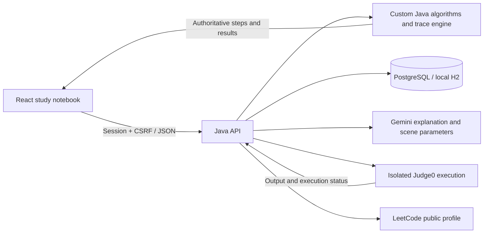

# 1on1 — Technical report

Advanced Algorithm CIA 3 · Semester V · 2026–27

This report describes the implemented system. Benchmark numbers belong to the exported results for the machine on which the experiments run. They must not be inferred from theoretical complexity. The team must add official student names, IDs, and actual individual contributions before submission.

## 1. Problem, users and success criteria

1on1 connects algorithm explanation with observable execution and deliberate practice. The target user is a student who can read pseudocode but needs to understand why a state transition is valid. Existing learning workflows scatter explanations, coding attempts, revision and progress across unrelated tools. The operational problem is finding relevant material, assembling focused practice and interpreting progress without turning the application into a passive content list.

The main workflow is an interactive notebook: read the idea, edit the experiment input, predict the next action, step through computed states, record an explanation and solve a related problem. A native coding submission is credited only after deterministic grading. A topic plan is produced by a coverage algorithm rather than a manually chosen static list. A prefix index drives catalog retrieval. Cohort summaries use randomized selection to obtain thresholds without requiring a full ranking.

Success means the workflow works end to end, saved state survives refresh, algorithms return correct interpretable outputs, and experiments show measured behavior at increasing sizes. The product contains 24 original lessons, 60 original judged problems, 420 fixtures and three paths. Synthetic benchmark records are labelled and do not appear as genuine student activity.

The platform deliberately describes activity rather than claiming to measure mastery. Lesson completion is a student's own acknowledgement. Native accepted problems, checkpoint answers, notes and imported profile statistics are separate forms of evidence.

<div style="page-break-before:always"></div>

## 2. Architecture and data flow

React/TypeScript provides the user interface, with shared design tokens, accessible controls and responsive notebook layouts. TanStack Query manages server state. Monaco and its worker are loaded only when a coding workspace is opened. Java 21-compatible Spring Boot code owns application logic, validation, assessed algorithms and execution traces. PostgreSQL is the deployment database; a persistent H2 database supports a simple local demonstration.



The `members` table stores account identifiers, emails, names, BCrypt password hashes and roles. `documents` stores typed content and user-owned learning records as JSON with a stable ID, owner, kind and update timestamp. Reset tokens are stored as hashes with expiry. Daily service usage is tracked per account, UTC day and service. Flyway manages the relational schema.

The document store keeps the small project's persistence model compact. It is a conscious tradeoff: JSON fields have weaker database-level validation and analytical query support than fully normalized lesson/submission tables. Controllers enforce domain validation and ownership; prepared statements avoid SQL interpolation. Public content uses a dedicated owner namespace. Private notes, drafts, plans and submissions require the authenticated member's owner ID.

Accounts use server sessions, HttpOnly cookies and CSRF tokens on mutations. Signup always creates a student. A content editor is bootstrapped only from explicit server configuration, never by trusting an email entered into public signup. Production cookies can require HTTPS. Password reset emails contain expiring one-use tokens; failed delivery does not reveal whether an account exists.

<div style="page-break-before:always"></div>

## 3. Assessed algorithms and correctness

### Trie: catalog prefix retrieval, Unit 4

Keys are trimmed and lowercased with a stable locale. Each character selects a child node. Terminal nodes hold unique record identifiers. Search follows the prefix, then performs lexicographic bounded enumeration, deduplicating records reachable through multiple indexed keys. The public search service publishes an immutable snapshot containing the trie and matching records. It is rebuilt after startup/content changes; requests do not rebuild it.

```text
insert(term, id):
  node = root
  for character in normalize(term):
    node = get-or-create node.children[character]
  node.ids.add(id)

search(prefix, limit):
  follow the normalized prefix from root
  if an edge is absent: return []
  enumerate terminal ids and descendants until limit unique ids
```

The path invariant is that the current node spells exactly the consumed prefix. A missing edge proves that no indexed key begins with the query. Enumerating below the final node yields only matching keys. Unique postings and output deduplication prevent duplicate results. With a bounded character alphabet, traversal is O(L), plus traversal/output needed for returned completions. Storage is O(total indexed characters plus postings); index construction and memory are distinct from query latency.

### Greedy set cover: topic practice plans, Unit 5

The universe is the student's requested topics. Each eligible unsolved problem contributes a topic set. The application filters difficulty and completion before constructing candidates. Every question has equal selection cost; questions-per-day grouping happens after coverage selection.

```text
remaining = requested topics
while remaining is not empty:
  choose unused candidate with greatest |topics ∩ remaining|
  break if every gain is empty
  record the newly covered topics
  remove them from remaining
return selected questions and remaining uncovered topics
```

The invariant is that `remaining` contains exactly the requested topics not covered by selected questions. Each useful iteration removes at least one topic, so the process terminates. If it stops with uncovered topics, no unused eligible question contributes any of them; reporting infeasibility is correct. Stable identifier tie-breaking makes demonstrations reproducible. Selection is an approximation: it does not guarantee the fewest possible questions. For unit-cost feasible set cover, the standard greedy quality bound is harmonic in the universe size. The straightforward implementation costs O(P·T·min(P,T)) with O(P·T) stored membership data.

### Randomized Quickselect: cohort activity thresholds, Unit 6 / CO5

The Java selector copies the input, samples a random pivot in the active interval, and performs a three-way partition into smaller, equal and larger values. It then continues only in the interval containing the requested zero-based order statistic.

```text
while low < high:
  pivot = randomly chosen value in [low, high]
  partition into < pivot, = pivot, > pivot
  if k is in the equal interval: return pivot
  otherwise retain only the interval containing k
return values[low]
```

The partition establishes that every smaller value precedes the equal interval and every greater value follows it. The desired rank therefore remains in the retained interval, or is already answered by the pivot. Three-way partitioning avoids repeatedly peeling identical pivots from duplicate-heavy data. Expected running time is O(n), worst case O(n²); the defensive copy uses O(n) space. Random seeds control reproducible experiments, not a claim of worst-case linear behavior.

Quartiles use the nearest-rank convention: rank `ceil(p*n)-1`, clamped to zero. Three selections still have expected O(n) total time because their count is constant. Ties are values, not an assertion that a specific proportion of students strictly outranks another. The independent cohort-summary endpoint reads scores without sorting or returning a full leaderboard. Native score uses unique accepted problems weighted 1/3/5 by difficulty; external profile totals do not affect it. This probabilistic algorithm gives the project meaningful CO5 coverage.

<div style="page-break-before:always"></div>

## 4. Visualization, AI and judging

The trace engine accepts a supported algorithm, bounded integer input, a target/window/rank, and optional words. It produces a versioned trace with independent state snapshots, variable values, active positions, pseudocode line references and explanatory text. A step's array is copied so later mutations cannot rewrite previous states. The frontend renders these records, rather than executing an assessed algorithm in browser libraries. Array, pointer, tree, heap, graph, DP, trie and coverage visualizations share rendering/control primitives.

Interactive sizes are deliberately bounded for interpretability. Large-scale performance evidence uses separate benchmark datasets. Recursion and DP have explicit scalar limits. Invalid input receives a useful message; the application does not silently coerce an invalid order-statistic rank. Graph scenes derive a small directed graph from the numeric input and disclose that construction. General arbitrary-source-code debugging is not represented as deterministic line tracing.

Gemini's structured mode selects supported scene parameters and supplies explanations. Java validates the proposed parameters and computes the trace. Normal tutoring streams text through the Java API; a question includes the current lesson, selected computed step, sanitized submission context and a bounded recent conversation. AI is never given hidden judge inputs. A student can request progressive guidance and save an explanation or supported experiment. Provider refusal, malformed output, interruption and free-tier exhaustion have explicit recovery states. Authored lessons remain usable without AI access.

Student code is sent only to the configured isolated Judge0 service. Source is saved as an immutable submission snapshot. A bounded worker pool creates jobs and polls their execution status, with network access disabled and CPU, wall-time, memory and output limits. Java applies the official input/output contract: normalized line endings and trailing whitespace, preserving internal content. Public tests may show input/expected/actual output; hidden tests show only status. Custom runs do not award solved credit. Repeated acceptance of one problem contributes only one solved identifier. Unavailable configuration never creates an accepted result.

<div style="page-break-before:always"></div>

## 5. Correctness and integration validation

The Java suite includes more than five tests for each assessed technique. Its explicit matrix covers:

| Technique | Correctness and boundary scenarios |
| --- | --- |
| Trie | Empty index/missing prefix; whitespace/case normalization; shared prefixes and bounded output; duplicate postings; zero/invalid limits. |
| Set cover | Empty goals; infeasible coverage; stable ties; overlapping coverage with newly added topics; seeded small datasets compared against exhaustive subset enumeration. |
| Quickselect | Single value; invalid/empty input; identical values; sorted/reversed/negative values; many ranks and seeds compared against sorting; input preservation; nearest-rank quartiles. |

The set-cover test's exact solver is restricted to tiny candidate sets and is a correctness/quality oracle, not a production replacement. Quickselect validation checks actual selected values rather than mirroring its partition implementation. Trace tests execute all supported scenes and verify bounds, independent snapshots, negative-window behavior, sorting results and DP consistency. The content test compiles every original Java reference solution and executes all 420 authored judge fixtures in a controlled test harness.

Runner contract tests use an isolated local fixture server. They validate hidden-case redaction, accepted-only credit, custom-run exclusion, language IDs, output normalization and unavailable-provider handling. They do not claim to test the hosted sandbox itself. Frontend API tests check CSRF propagation, service errors and interrupted streaming. HTTP tests exercise real Java sessions, registration, permissions, persistence, planner output, benchmark APIs and logout.

Browser tests cover guest learning and trace controls, checkpoints, opening practice, account onboarding, persisted notes, plans, cohorts, code drafts, desktop/mobile overflow and application errors. Screenshots are inspected as visual evidence. The frontend production build and dependency audit complement functional tests; a successful build alone does not establish end-to-end correctness.

Live Gemini answers, actual hosted Java/Python/C++ execution, email delivery and LeetCode availability need configured external services and must be recorded separately from offline/adapter tests. No test result should be labelled live simply because its request shape was validated.

<div style="page-break-before:always"></div>

## 6. Experimental method and interpretation

The evidence API uses seed 42, two warm-up runs and five measured repetitions. Inputs increase through 1,000/10,000/100,000 records for trie and selection, and 100/1,000/10,000 candidate questions for set cover. It returns arithmetic mean timings with Java version, operating system, processor count, sample sizes and seed. The UI displays comparative tables/bars and exports the exact JSON.

Quickselect is compared with sorting a copied score array and reading the corresponding rank. Trie query timing is compared with linear prefix scanning; trie construction is excluded and must be disclosed. A prefix with many outputs can dominate traversal cost. Catalog size, prefix distribution, allocation and repeated-query conditions affect the practical benefit of indexing.

Set cover is compared with accepting the first candidate that adds any uncovered topic. The application reports selected-question counts and uncovered topics in addition to time. Greedy selection may be slower than the simple baseline while producing a more compact plan. The correct conclusion is about the tradeoff between coverage quality and computational work, not automatic superiority on every metric.

In-process timings exclude HTTP, database and network latency and are not a substitute for a calibrated JMH study. JVM compilation, garbage collection and machine contention introduce noise. Repeat on the demonstration machine and retain raw exports. Never claim that expected linear selection guarantees the fastest result for a tiny cohort. Small cohorts can be handled correctly even when performance differences are too small to be meaningful.

The benchmark generators use realistic synthetic collections for reproducibility. Native cohort scores become actual data through judged work. Synthetic benchmark users are not inserted into live progress, and no number of generated records is described as product adoption.

The [validation record](VALIDATION.md) contains the actual measured table and links to all raw exports. At 100,000 records in this run, Quickselect averaged 6.21938 ms against 22.70114 ms for sorting; indexed prefix retrieval averaged 0.06134 ms against a 14.49820 ms scan with construction excluded. On 10,000 practice candidates, greedy coverage selected eight questions instead of fifteen but took 294.26538 ms versus 0.09720 ms. These observations support different conclusions: indexing/selection helped these queries, while set cover improved plan compactness at an additional computational cost. They do not establish universal speedups.

<div style="page-break-before:always"></div>

## 7. Reproducibility, limitations and contribution record

The repository includes frontend dependency locks, Maven build files, SQL migration, original content and its deterministic generator, Java tests, HTTP/browser checks, container definitions and deployment instructions. Local demonstration needs Java, Maven and Node; persistent H2 removes a mandatory database-installation step. Deployment runs the same business logic with PostgreSQL. The sample student account is development-only and starts without fabricated achievements. Production must use explicit service secrets and administrator credentials.

The LeetCode connector reads public profile statistics and recent accepted submissions through an unofficial endpoint. It caches the last successful snapshot, supports a manual cooldown and refreshes periodically. It does not prove profile ownership, import every historical accepted problem, or turn external counts into native grading credit. Network restrictions and upstream changes are material limitations.

Other limitations are purposeful: visualization input sizes favor understanding; arbitrary student code is not instrumented for line tracing; AI explanations can be wrong despite schema validity; external free tiers can be exhausted; sessions are held in one Java instance and reset on application restart; the compact JSON document model is suitable for this project's scale but would need normalization/query work for a large production service. Scaling to multiple replicas would require shared sessions, distributed quotas and a durable job queue. These are deployment boundaries, not claims that offline fixtures validate production infrastructure.

Before submission, record each student's actual responsibility, commits, algorithm explanation and validation contribution. Use the team-development sections as ownership areas rather than inventing completed student work. Every member should explain a critical Java method, a correctness invariant, time/space behavior, and an observed failure case. Demonstrate the application on changed input, not only the seed example. The companion demonstration script maps the finished workflows to the assessment evidence.
